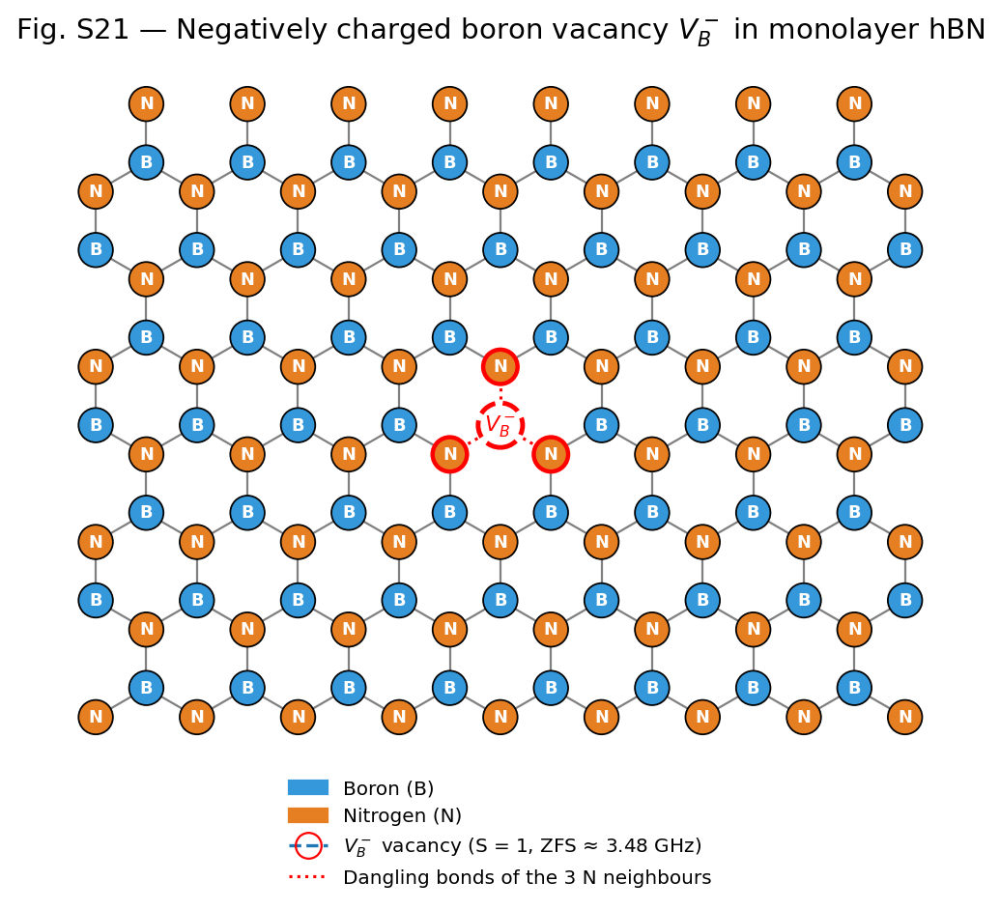
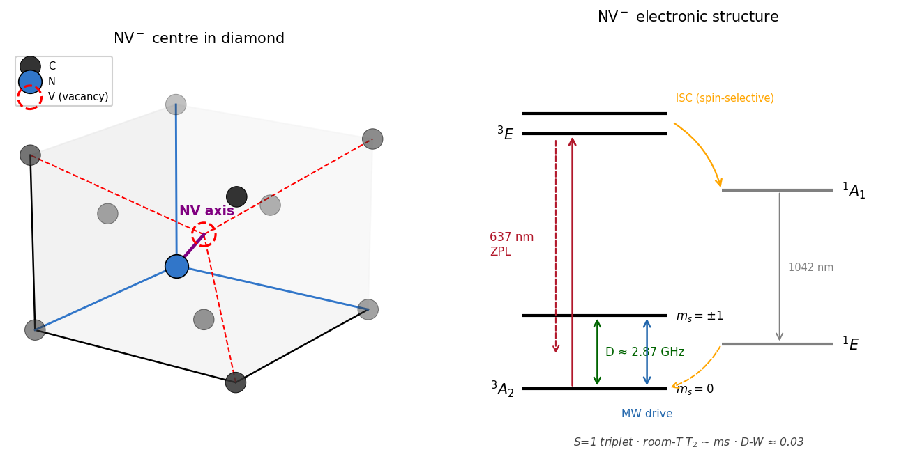
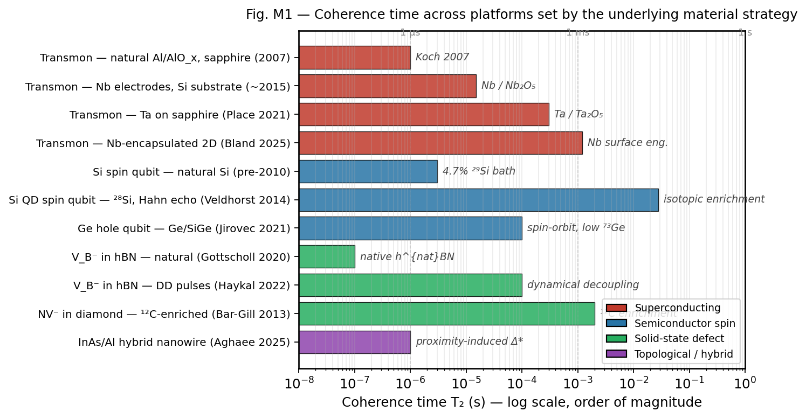

# Quantum Materials Figures

This repository holds the code for the figures in my M.Sc. thesis.

> **Nanomaterials for the Hardware of Quantum Devices: From Material Limitations of Existing Platforms to Defect Engineering in Hexagonal Boron Nitride**
> Ayoub Elmqarta · ENS Meknès, Moulay Ismail University, Morocco · 2026

One Python script produces all 21 figures. They show crystal structures, electronic level schemes, the V_B⁻ spin defect in hBN, and comparisons of the materials used in superconducting, spin, photonic, topological and defect-based quantum platforms.

<p align="center">
  
  
</p>
<p align="center">
  
</p>

## Usage

```bash
pip install -r requirements.txt
python make_figures.py        # writes 21 PNGs to ./figures/
```

Every figure is built by its own function in `make_figures.py`. To edit a figure, change the value in its function and run the script again.

## Figure index

| ID | Figure | Thesis section |
|---|---|---|
| S1 | Transmon anharmonicity | §1.2.1 Superconducting qubits |
| S2 | Surface-code below-threshold scaling | §1.2.1, §1.3.3 |
| S3 | Zeeman splitting of a spin-1/2 | §1.2.2 Semiconductor spin qubits |
| S4–S7 | Al (FCC), Nb (BCC), NbN and TiN (rocksalt) | §2.1.1 Superconducting materials |
| S8–S11 | Si, Ge (diamond cubic), GaAs, InAs (zincblende) | §2.1.2 Semiconductor materials |
| S12 | Bi₂Te₃ quintuple layers + Dirac surface state | §2.1.3 Topological / hybrid |
| S13 | InAs/Al hybrid nanowire, proximity effect | §2.1.3 |
| S14 | NV⁻ centre in diamond + level scheme | §2.1.4 Photonic materials |
| S15 | Si₃N₄ waveguide / SiO₂ fibre | §2.1.4 |
| S20 | Stress–strain: hBN monolayer vs steel | §2.5 hBN mechanical properties |
| S21 | V_B⁻ defect in the hBN honeycomb lattice | §2.5.2 Defect-based quantum emitters |
| M1 | Coherence time vs material strategy | §1.3.1 |
| M2 | 1/f two-level-system noise across interfaces | §1.3.2 |
| M3 | Gate-error progression vs surface-code threshold | §1.3.3 |
| M4 | JJ frequency disorder and qubit-count scaling | §1.3.4 |

## About the numbers

Material constants (lattice parameters, band gaps, critical temperatures and fields, zero-field splittings) come from the literature cited in the thesis. Many figures name their key source.

M1–M4 are **schematic syntheses**. They gather published results from different groups and years, so read them as order-of-magnitude comparisons, not as one consistent dataset. The values in M4(a) are illustrative only. Check the original papers before reusing any number from M1–M4.

## Thesis summary

The thesis compares carbon-, silicon- and oxygen-related point defects in hBN as room-temperature single-photon emitters and spin qubits, using the negatively charged boron vacancy V_B⁻ as a reference. Results from more than 100 first-principles and experimental studies are put on a common basis with one framework. The framework scores each defect on formation energy, charge-state stability, deep-level position, optical signature (ZPL, Huang–Rhys and Debye–Waller factors) and experimental confirmation. It also keeps track of the DFT methods each study used, such as PBE vs HSE06 and supercell conventions.

## License

MIT. You are free to reuse the code; please cite the thesis if you use the figures.

## Contact

Ayoub Elmqarta · a.elmqarta@edu.umi.ac.ma
